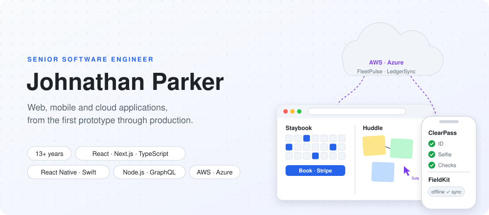

<picture>
  <source media="(prefers-color-scheme: dark)" srcset="./hero-dark.svg" />
  
</picture>

### Selected work

🌐 &nbsp;**Staybook** · direct booking for vacation-rental hosts, with live availability and Stripe checkout 
🌐 &nbsp;**Huddle** · a real-time whiteboard where every sticky note and cursor stays in sync 
📱 &nbsp;**ClearPass** · identity onboarding: ID capture, selfie match and a clear status for each step 
📱 &nbsp;**FieldKit** · an offline-first app for field technicians that syncs when the signal returns 
☁️ &nbsp;**FleetPulse** · cold-chain monitoring that flags temperature trouble before anything spoils 
☁️ &nbsp;**LedgerSync** · keeps invoices and payments matched between commerce and accounting systems

